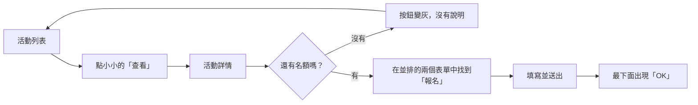
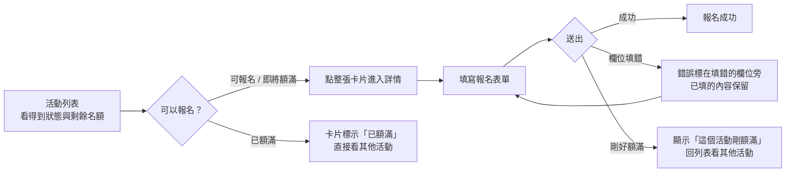

# 02 — 新的報名流程（Lab 3）

> 講師示範版本。對應 `01-problem.md` 的問題編號。

## 改版前（6 步）

## 改版後（4 步）

| 步驟 | 使用者看到什麼 | 使用者做什麼 | 解決的問題 |
|---|---|---|---|
| 1 活動列表 | 標題最大；日期地點次要；狀態標籤＋剩餘名額 | 掃一眼決定要點哪一個 | P1、P2、P4 |
| 2 活動詳情 | 名額狀態；報名表單是主角，取消報名收合在下方 | 填姓名、學號、Email | P5 |
| 3 送出 | 按鈕顯示「送出中…」且不能再按 | 等待 | P8 |
| 4 結果 | 成功訊息；或錯誤標在欄位旁 | 完成，或改完再送出 | P7 |

## Edge Case

| 情況 | 使用者看到什麼 | 下一步 |
|---|---|---|
| 已額滿 | 卡片寫「已額滿」，不只靠紅色 | 看其他活動 |
| 重複報名 | 「這個學號已經報名過了」 | 回列表 |
| 欄位填錯 | 錯誤標在填錯的欄位旁 | 改完再送出，已填的不消失 |
| 網路失敗 | 「沒有送出成功，請再試一次」 | 重試 |

## 待討論

- 已額滿時要不要提供「加入候補」？（目前系統沒有候補功能，需要後端一起改）
- 「我的報名」頁面：重複報名時要導去哪裡？（目前沒有這個頁面）
- 取消報名要不要先確認一次，避免誤按？
